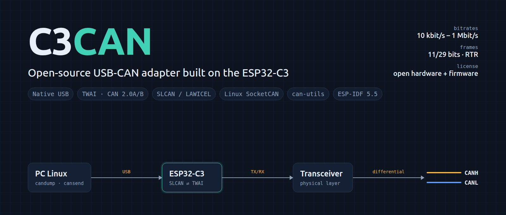
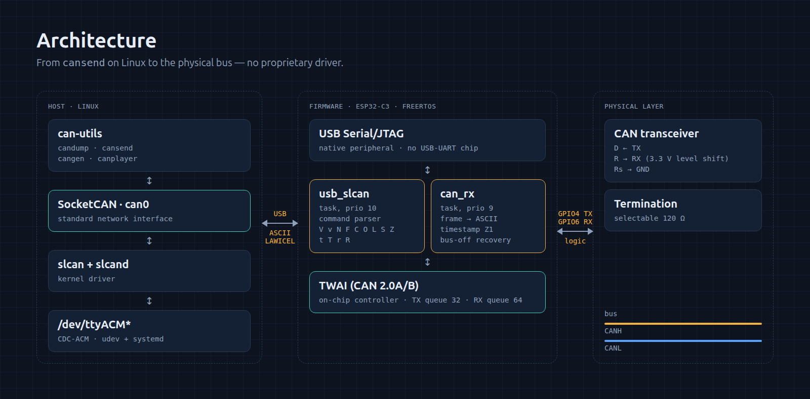
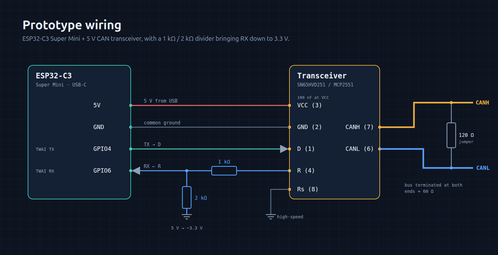

# C3CAN

<p align="center">
  
</p>

<p align="center">
  <strong>Open-source USB-CAN adapter based on the ESP32-C3</strong><br>
  Native USB • TWAI/CAN 2.0 • SLCAN/LAWICEL • Linux SocketCAN • ESP-IDF • KiCad
</p>

> **Project status:** active development / prototype stage.  
> The USB/SLCAN/SocketCAN path has been bench-tested on Linux, including bidirectional traffic at 500 kbit/s against an independent STM32 CAN node. The custom KiCad PCB is nearly finished and its manufacturing files will be published here soon.

---

## Overview

**C3CAN** is an open-source USB-to-CAN adapter built around the **ESP32-C3**.

The project uses:

- the ESP32-C3 native **USB Serial/JTAG** interface as the host connection;
- the ESP32-C3 **TWAI** controller for Classical CAN;
- an external CAN transceiver;
- the **LAWICEL/SLCAN** serial protocol;
- Linux **SocketCAN** through `slcan`;
- standard tools from **can-utils**, including `candump`, `cansend`, `cangen` and `canplayer`.

The goal is to provide a small, reproducible and well-documented USB-CAN interface that can be built, studied and modified by students, embedded developers and electronics enthusiasts.

C3CAN is **Classical CAN only**. CAN FD is not currently supported.

---

## Why C3CAN?

The ESP32-C3 already includes a TWAI controller and a native USB Serial/JTAG peripheral, so an external CAN controller such as the MCP2515 is not required.

<p align="center">
  
</p>

The basic architecture is:

```text
Linux PC
   │
   │ USB
   ▼
USB Serial/JTAG
   │
   ▼
ESP32-C3
   │
   │ SLCAN / LAWICEL
   │
   ▼
TWAI
   │
GPIO4 TX
GPIO6 RX
   │
   ▼
CAN transceiver
   │
   ├── CANH
   └── CANL
```

On Linux:

```text
/dev/ttyACM*
      │
      ▼
    slcan
      │
      ▼
     can0
      │
 ┌────┼─────────────┐
 ▼    ▼             ▼
candump cansend   canplayer
```

---

## Current prototype hardware

<p align="center">
  
</p>

The bench prototype uses:

- ESP32-C3 Super Mini
- 5 V high-speed CAN transceiver (SN65HVD251; the MCP2551 has the same pinout)
- GPIO4 as TWAI TX → transceiver `D`
- GPIO6 as TWAI RX ← transceiver `R`, through a 1 kΩ / 2 kΩ divider (5 V → ~3.3 V)
- transceiver `Rs` tied to GND (high-speed mode)
- 5 V for the transceiver from the USB-powered board
- common ground between ESP32-C3 and transceiver
- 100 nF local decoupling at the CAN transceiver
- selectable ~120 Ω CAN termination
- Classical CAN at up to 1 Mbit/s

### Important prototype note

The SN65HVD251/MCP2551 are 5 V transceivers while the ESP32-C3 uses 3.3 V I/O. The prototype therefore uses a 1 kΩ / 2 kΩ resistor divider on RX. The TX line is driven directly at 3.3 V: this is fine for the SN65HVD251 (`D` input V<sub>IH</sub> = 2 V), but marginal for the MCP2551 (V<sub>IH</sub> = 0.7 × V<sub>DD</sub> ≈ 3.5 V), which is one more reason the PCB will move to a 3.3 V-compatible transceiver.

RX was moved from GPIO5 to GPIO6 during bring-up. The pins are defined in `main/can_twai.c` (`CAN_TX_GPIO` / `CAN_RX_GPIO`).

For the custom PCB, the preferred direction is to use either:

1. a CAN transceiver with logic levels directly compatible with 3.3 V, or
2. a transceiver with a dedicated VIO pin, or
3. explicit level translation designed from datasheet limits.

The production PCB should not rely on an unverified resistor-divider interface alone.

---

## Firmware

Firmware is developed using:

- **ESP-IDF 5.5.x**
- C
- FreeRTOS
- ESP32-C3 native USB Serial/JTAG driver
- ESP32 TWAI driver

Current project structure:

```text
C3CAN/
├── CMakeLists.txt
├── sdkconfig.defaults
├── main/
│   ├── CMakeLists.txt
│   ├── main.c
│   ├── usb_slcan.c          # USB Serial/JTAG + SLCAN parser, CAN RX task
│   ├── usb_slcan.h
│   ├── can_twai.c           # TWAI driver wrapper, bitrates, status, bus-off recovery
│   └── can_twai.h
├── linux/
│   ├── 50-c3can.rules.example
│   └── c3can@.service
├── docs/
│   └── images/
└── README.md
```

Coming next: `hardware/kicad/` (schematic, PCB, Gerbers, BOM) and `LICENSE` files.

### Firmware behavior

- default bitrate after boot: **500 kbit/s** (`S6`); the host can change it with `S0`...`S8` while the channel is closed;
- TWAI queues: 32 frames TX, 64 frames RX;
- **automatic bus-off recovery**: if the controller enters BUS-OFF (TEC > 255), the RX task calls `twai_initiate_recovery()` and restarts the controller once recovery completes, so the adapter does not stay silent until the host sends `C`/`O` again (`slcand` only sends `O` once at startup).

---

## Implemented SLCAN commands

Current firmware work includes support for the following LAWICEL/SLCAN-style commands:

| Command | Function | Status |
|---|---|---|
| `V` | Hardware version | Implemented |
| `v` | Firmware version | Implemented |
| `N` | Serial number | Implemented |
| `F` | CAN status flags | Implemented |
| `C` | Close CAN channel | Implemented |
| `O` | Open CAN channel | Implemented |
| `L` | Listen-only mode | Implemented |
| `S0`...`S8` | Standard CAN bitrates | Implemented |
| `s43A301` | Compatibility alias for 250 kbit/s | Implemented |
| `t` | Standard 11-bit CAN frame | Implemented |
| `T` | Extended 29-bit CAN frame | Implemented |
| `r` | Standard RTR frame | Implemented |
| `R` | Extended RTR frame | Implemented |
| `Z0` | Timestamp disabled | Implemented |
| `Z1` | Timestamp enabled | Implemented |

> `s43A301` is currently a compatibility command used by an existing USBtin/Linux workflow. It maps to ESP32-C3 TWAI at 250 kbit/s. Arbitrary MCP2515 register-style `sXXXXXX` timing values are not yet implemented.

---

## Supported bitrates

The current firmware maps standard SLCAN speed commands to:

```text
S0 = 10 kbit/s
S1 = 20 kbit/s
S2 = 50 kbit/s
S3 = 100 kbit/s
S4 = 125 kbit/s
S5 = 250 kbit/s
S6 = 500 kbit/s
S7 = 800 kbit/s
S8 = 1 Mbit/s
```

---

## Build

Install ESP-IDF and open an ESP-IDF-enabled terminal.

```bash
idf.py set-target esp32c3
idf.py build
```

Flash using the native USB Serial/JTAG port:

```bash
idf.py -p /dev/ttyACM0 flash
```

The actual ACM number may change between systems.

A more stable path can be found with:

```bash
ls -l /dev/serial/by-id/
```

---

## Linux / SocketCAN

Install can-utils:

```bash
sudo apt install can-utils
```

Load the required kernel modules:

```bash
sudo modprobe can
sudo modprobe can_raw
sudo modprobe slcan
```

Attach the C3CAN adapter at 500 kbit/s (`S6`, default; use `-b43A301` for the 250 kbit/s compatibility timing):

```bash
sudo slcan_attach -f -s6 -o /dev/ttyACM0
sudo slcand ttyACM0 can0
sudo ip link set can0 txqueuelen 1000
sudo ip link set can0 up
```

Check the interface:

```bash
ip -details link show can0
```

With SLCAN, Linux may display:

```text
bitrate 0
```

because the actual bitrate is configured inside the adapter through the serial protocol rather than through SocketCAN Netlink configuration.

---

## can-utils examples

Monitor traffic:

```bash
candump can0
```

Transmit a standard CAN frame:

```bash
cansend can0 123#11223344
```

Generate traffic:

```bash
cangen can0
```

Replay a CAN log:

```bash
canplayer -I capture.log
```

---

## Automatic setup with udev + systemd

C3CAN can be configured so that connecting the board automatically creates `can0`.

Example device identification for the current development board:

```text
VID: 303a
PID: 1001
Device: Espressif USB JTAG/serial debug unit
```

A udev rule can start a systemd template service when the ESP32-C3 ACM device appears.

Recommended repository layout:

```text
linux/
├── 50-c3can.rules
└── c3can@.service
```

Example service concept:

```ini
[Unit]
Description=C3CAN USB-CAN adapter on %I
BindsTo=dev-%i.device
After=dev-%i.device

[Service]
Type=simple
ExecStartPre=/usr/sbin/modprobe can
ExecStartPre=/usr/sbin/modprobe can_raw
ExecStartPre=/usr/sbin/modprobe slcan
ExecStart=/usr/bin/slcand -F -c -f -s6 -o /dev/%I can0
ExecStartPost=/usr/sbin/ip link set can0 txqueuelen 1000
ExecStartPost=/usr/sbin/ip link set can0 up
ExecStopPost=-/usr/sbin/ip link set can0 down
Restart=on-failure
RestartSec=1
```

For a public release, the udev rule should avoid hard-coding a developer-specific serial number unless that is intentional. A dedicated USB identity or persistent symlink strategy is preferable for the final hardware.

---

## CAN termination

A CAN bus should normally be terminated at both physical ends.

For a two-node bench setup:

```text
        120 Ω                              120 Ω
CANH ───/\/\──────────── bus ─────────────/\/\── CANH
CANL ─────────────────────────────────────────── CANL
```

With power removed, a correctly terminated two-end bus normally measures approximately:

```text
CANH ↔ CANL ≈ 60 Ω
```

The C3CAN PCB is planned to include switchable/jumper-selectable termination.

---

## Development status

### Validated

- [x] ESP32-C3 native USB Serial/JTAG
- [x] USB serial echo
- [x] SLCAN command parser
- [x] TWAI open/close
- [x] 500 kbit/s default (`S6`)
- [x] 250 kbit/s compatibility command (`s43A301`)
- [x] Linux `slcan`
- [x] SocketCAN `can0`
- [x] `candump`
- [x] `cansend`
- [x] udev + systemd automatic interface creation
- [x] SLCAN status command infrastructure
- [x] timestamp enable/disable infrastructure
- [x] bidirectional traffic at 500 kbit/s with an STM32G431 (NUCLEO) CAN node — ACK OK, TEC/REC = 0
- [x] automatic bus-off recovery

### Implemented, additional validation recommended

- [ ] Extended 29-bit CAN frames
- [ ] RTR frames
- [ ] Timestamp behavior under sustained RX load
- [ ] Error-warning / error-passive transitions under fault injection
- [ ] Long-duration traffic and queue stress
- [ ] Physical TX/RX test matrix using a second independent CAN adapter

### Planned

- [ ] KiCad schematic
- [ ] KiCad PCB
- [ ] ESD protection
- [ ] CAN common-mode choke footprint
- [ ] switchable 120 Ω termination
- [ ] TX/RX/status LEDs
- [ ] USB-C connector on custom board
- [ ] 3D-printable enclosure
- [ ] manufacturing files
- [ ] BOM
- [ ] hardware bring-up guide
- [ ] automated firmware tests
- [ ] GitHub Actions build

---

## Planned PCB

The goal for the custom PCB is:

```text
USB-C
  │
  ▼
ESP32-C3
  │
  ▼
3.3 V-compatible CAN transceiver
  │
  ├── protection
  ├── optional common-mode choke
  ├── selectable termination
  │
  ▼
CANH / CANL / GND
```

The PCB is nearly finished. The KiCad source files, Gerbers, BOM and assembly drawings will be published in this repository so anyone can order and assemble the board.

---

## Project goals

C3CAN is intended to be useful as:

- an educational CAN interface;
- an embedded-systems development tool;
- a Linux SocketCAN adapter;
- a CAN protocol debugging interface;
- a reference design for ESP32-C3 + TWAI + native USB;
- an open hardware/firmware portfolio project.

It is not intended to be presented as a certified automotive, industrial or safety-critical interface.

---

## Prior art and references

This project was developed with reference to existing open-source projects, protocols and vendor documentation.

### USBtin

Thomas Fischl's USBtin is an important reference for the USB-to-CAN architecture and LAWICEL/SLCAN command behavior.

- Project: https://www.fischl.de/usbtin/

C3CAN is an independent ESP32-C3 implementation and is not affiliated with USBtin.

### linux-can / can-utils

Linux SocketCAN integration, `slcan`, `candump`, `cansend`, `cangen` and `canplayer` are provided by the Linux CAN ecosystem.

- Repository: https://github.com/linux-can/can-utils

### Espressif ESP-IDF

The firmware relies on Espressif's ESP-IDF, USB Serial/JTAG support and TWAI peripheral APIs.

- ESP-IDF: https://github.com/espressif/esp-idf
- Documentation: https://docs.espressif.com/projects/esp-idf/

### esp32-slcan

The `mintynet/esp32-slcan` project was reviewed as prior art for ESP32-based SLCAN adapters.

- Repository: https://github.com/mintynet/esp32-slcan

C3CAN does not claim that code from this project is incorporated unless a future commit explicitly identifies copied or adapted source and preserves the applicable license and attribution.

### Other open USB-CAN implementations

Other open USB-CAN projects were also reviewed to understand common architecture and documentation practices.

One example is:

- https://github.com/bmc-labs/usb-can

---

## AI-assisted development

AI tools were used during development as an engineering assistant.

In particular, OpenAI's ChatGPT and Anthropic's Claude (Claude Code) were used for tasks including:

- brainstorming architecture and naming;
- discussing ESP32-C3, TWAI and SLCAN integration;
- reviewing and restructuring firmware code;
- debugging build and Linux integration issues;
- drafting documentation;
- organizing tests and repository structure.

The project maintainer is responsible for the hardware design, implementation choices, bench assembly, measurements, firmware flashing, validation and final review.

AI-generated suggestions should be treated like any other engineering input: they must be checked against datasheets, vendor documentation, source code and physical measurements before being relied upon.

---

## Attribution policy

If source code is copied or adapted from another project in the future:

1. the original project and author must be identified;
2. the original license must be preserved;
3. the affected file or section should contain a clear attribution notice;
4. the repository license must remain compatible with the upstream license.

References or protocol compatibility alone do not imply that third-party source code is included.

---

## Licensing

A suggested licensing model is:

- **Firmware and Linux scripts:** MIT License
- **Hardware / KiCad design:** CERN Open Hardware Licence Version 2 – Permissive (CERN-OHL-P-2.0)
- **Documentation:** CC BY 4.0

Before the first public release, add the final license files and make sure any third-party code incorporated into the repository is license-compatible.

---

## Contributing

Issues, tests, documentation fixes, hardware reviews and pull requests are welcome.

Useful contribution areas include:

- TWAI/SLCAN protocol compatibility;
- Linux SocketCAN testing;
- PCB review;
- ESD/EMC improvements;
- enclosure design;
- CI builds;
- additional Linux distributions;
- Windows/macOS host compatibility.

---

## Disclaimer

This project is under active development.

Do not use it as the sole interface for safety-critical, production automotive, industrial-control or other systems where malfunction could cause injury or damage.

Verify electrical levels, isolation, grounding, termination and protection requirements for your application.

---

## Author

Developed as an open-source electronics and embedded-systems project.

If you build C3CAN, open an issue or discussion and share your setup.
